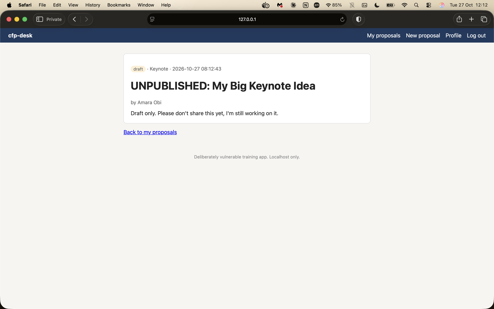

   # Finding 1: Any speaker can read other speakers' draft proposals (IDOR)

   **OWASP category:** A01 Broken Access Control
   **Severity:** Medium (CVSS 3.1: 6.5)
   **Where:** `GET /proposals/{id}` in `handlers.go` (`showProposal`)

   ## Steps to reproduce
   1. Log in as `kofi` / `password123`.
   2. Open your own proposal at `127.0.0.1:8080/proposals/3`.
   3. Change the address to `127.0.0.1:8080/proposals/2`.

   ## What happens
   Amara's draft proposal, "UNPUBLISHED: My Big Keynote Idea", is shown, even though it belongs to another speaker and is marked as a draft.

   ## Why it matters
   Any logged-in speaker can read other speakers' draft proposals just by changing the number in the address. A speaker could copy someone else's talk idea before it's submitted, and the speakers whose drafts were exposed would lose trust in the event and its organisers.

   ## Root cause
   The app looks up the proposal by its ID only. It never checks that the proposal belongs to the logged-in speaker.

   ## Evidence
   