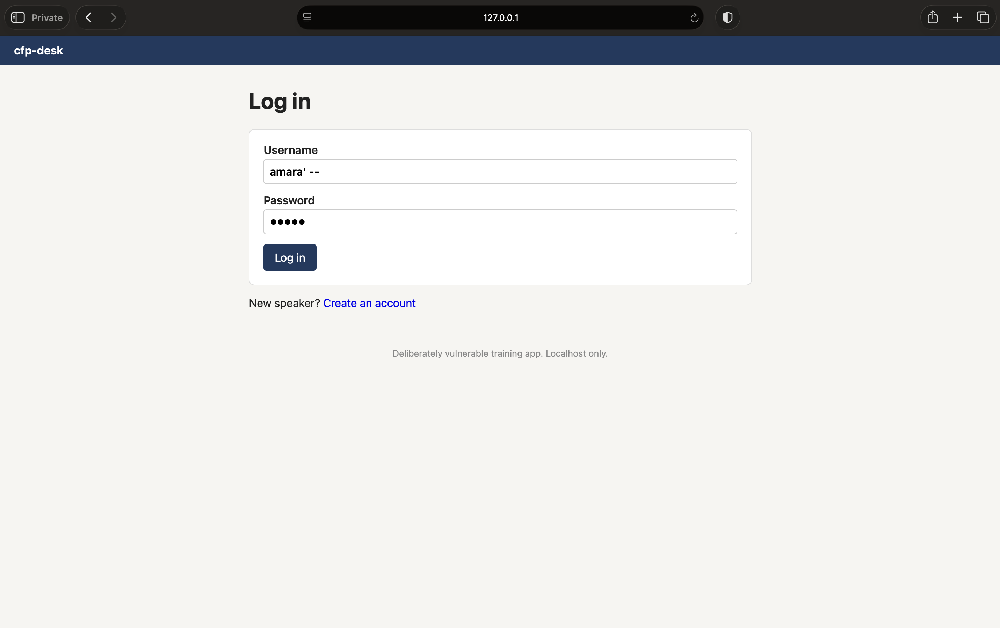
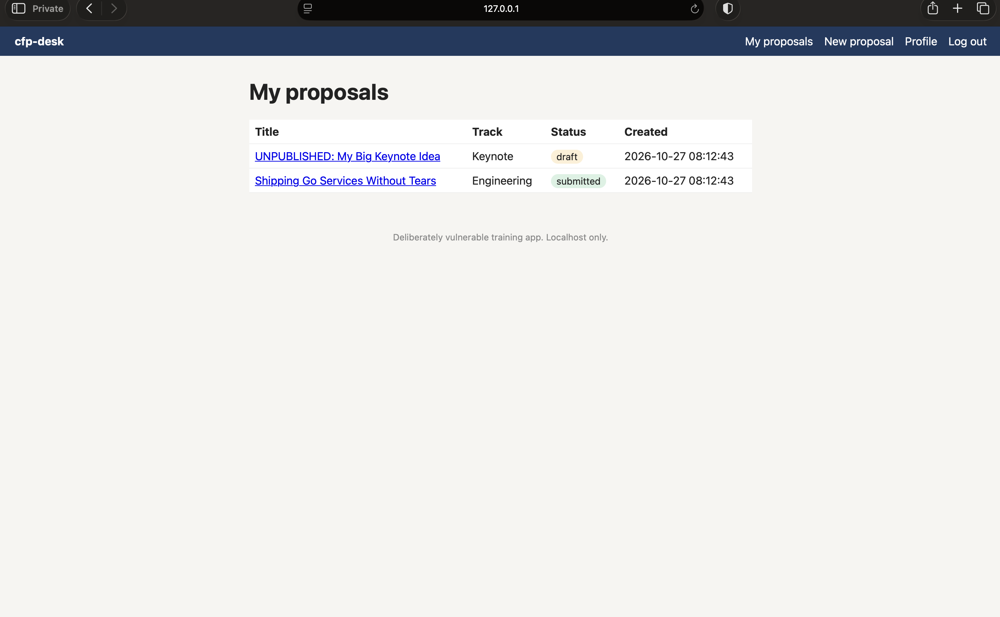

# Finding 2: Login bypass with SQL injection

**OWASP category:** A05 Injection (OWASP Top 10 2025)
**Severity:** Critical (CVSS 3.1: 9.1)
**Where:** `POST /login` in `handlers.go` (`login`)

## Steps to reproduce
1. Go to `127.0.0.1:8080/login`.
2. Enter the username `amara' --` (with the quote mark, a space and two dashes).
3. Enter any password, for example `wrong`.
4. Click Log in.

## What happens
I am logged in to Amara's account without knowing her password. I can see her proposals, including her unpublished draft, edit her profile, and create proposals as her.

## Why it matters
Anyone, even without an account, can log in as any speaker whose username they know. On a CFP platform, an attacker could read, change or submit proposals under someone else's name, and if an organiser account exists, take over the whole event's submissions.

## Root cause
The login code builds its SQL query by pasting the username straight into the query text. The quote mark closes the username early, and `--` turns the rest of the query, including the password check, into a comment.

## Evidence

