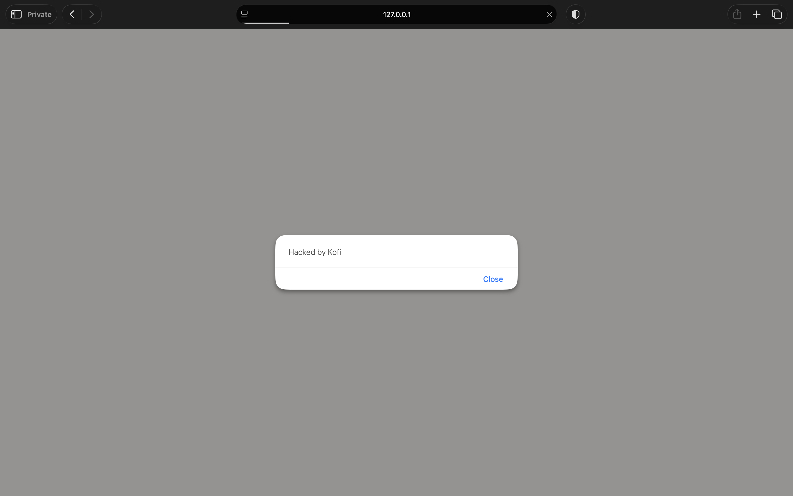
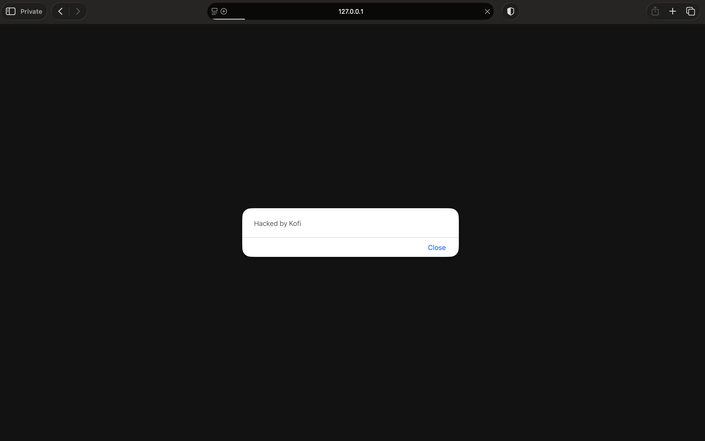
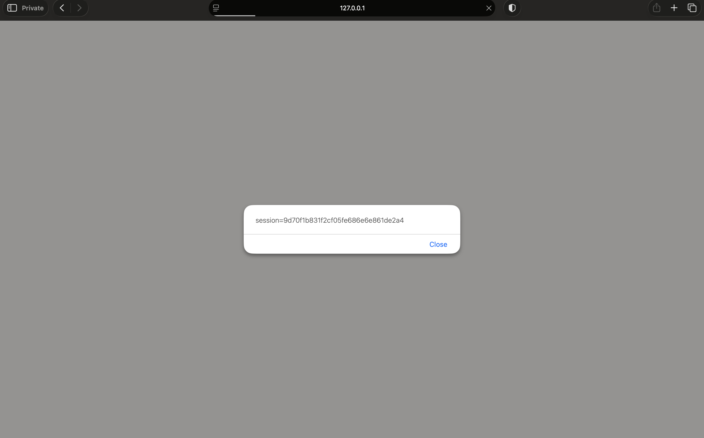

# Finding 3: Stored XSS in proposal abstracts

**OWASP category:** A05 Injection (OWASP Top 10 2025)
**Severity:** High (CVSS 3.1: 8.7)
**Where:** `GET /proposals/{id}` in `handlers.go` (`showProposal`), and `templates/proposal.html`

## Steps to reproduce
1. Log in as `kofi` / `password123`.
2. Create a new proposal with this abstract: ``
3. Save it. The pop-up appears straight away.
4. Log out, log in as `amara` / `sunshine1`, and open the same proposal (`/proposals/4`).
5. The pop-up appears in Amara's browser too.
6. A second proposal with `` shows the session cookie.

## What happens
Whatever a speaker writes in the abstract runs as JavaScript in the browser of everyone who opens the proposal, including other speakers. The script can read the session cookie, which is all an attacker needs to log in as that person.

## Why it matters
On a CFP platform, organisers and reviewers open proposals all the time. A speaker could hide a script in their abstract, steal an organiser's session when they review it, and take over the organiser's account: reading every submission or changing which talks are accepted.

## Root cause
The app marks the abstract as "safe" HTML (`template.HTML`), so Go does not escape it, and the browser runs any `<script>` inside. The session cookie also has no `HttpOnly` flag, so scripts can read it (see Finding 5).

## Evidence

