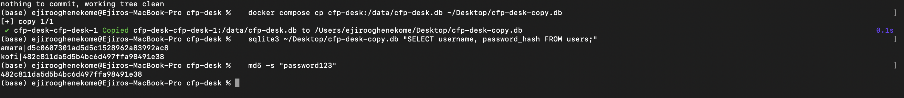
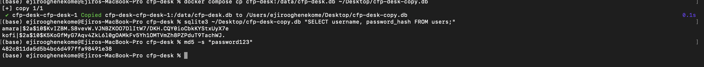

# Finding 4: Passwords stored with unsalted MD5

**OWASP category:** A04 Cryptographic Failures (OWASP Top 10 2025)
**Severity:** High (CVSS 3.1: 7.5, if the database is leaked)
**Where:** `hashPassword` in `db.go`

## Steps to reproduce
1. Copy the database out of the container:
   `docker compose cp cfp-desk:/data/cfp-desk.db ~/Desktop/cfp-desk-copy.db`
2. List the stored hashes:
   `sqlite3 ~/Desktop/cfp-desk-copy.db "SELECT username, password_hash FROM users;"`
3. Hash a common password: `md5 -s "password123"`

## What happens
The result matches Kofi's stored hash exactly. MD5 is fast and unsalted, so the same password always gives the same hash.

## Why it matters
If the database is ever stolen, an attacker can crack most passwords in seconds by hashing lists of common passwords and matching them. Many people reuse passwords, so the attacker can then try them on the speakers' other accounts, such as email or GitHub (credential stuffing).

## Root cause
Passwords are hashed with plain MD5 and no salt, instead of a slow, salted algorithm like bcrypt or Argon2.

## Evidence

## Fix
Passwords are now hashed with bcrypt (`golang.org/x/crypto/bcrypt`) instead of MD5. bcrypt adds a random salt, so the same password gives a different hash each time, and it is deliberately slow, so cracking a stolen database takes far longer. Login fetches the stored hash and checks it with `bcrypt.CompareHashAndPassword`.

