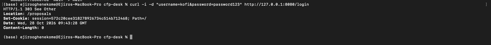

# Finding 5: Session cookie without security flags, and no security headers

**OWASP category:** A02 Security Misconfiguration (OWASP Top 10 2025)
**Severity:** Medium (CVSS 3.1: 5.4)
**Where:** `setSessionCookie` in `session.go`, and every response

## Steps to reproduce
1. Run: `curl -i -d "username=kofi&password=password123" http://127.0.0.1:8080/login`
2. Look at the `Set-Cookie` line and the other headers.

## What happens
The cookie is set as `session=...; Path=/` with no `HttpOnly`, `Secure` or `SameSite` flags. The response also has no security headers, such as `Content-Security-Policy`, `X-Frame-Options` or `X-Content-Type-Options`.

## Why it matters
Without `HttpOnly`, any script on the page can read the session cookie. Together with the stored XSS in Finding 3, an attacker can steal a speaker's or organiser's session and log in as them. Without security headers, the browser has no extra protection to block injected scripts.

## Root cause
The session cookie is created without security flags, and the app never sets security headers.

## Evidence
